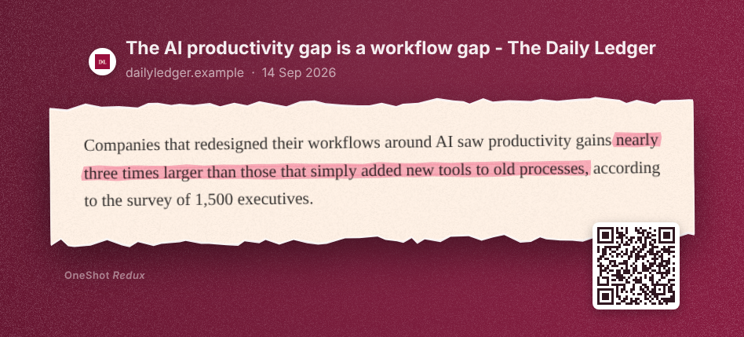
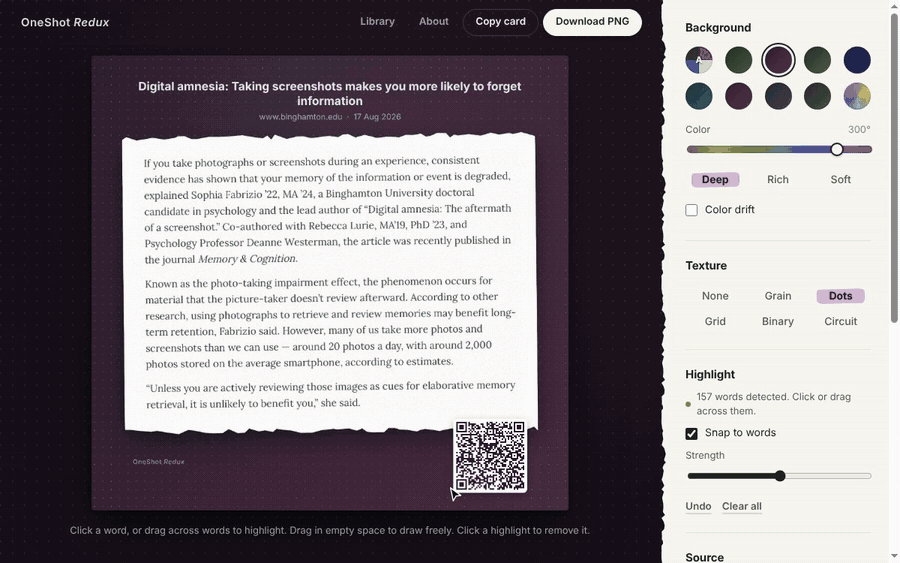
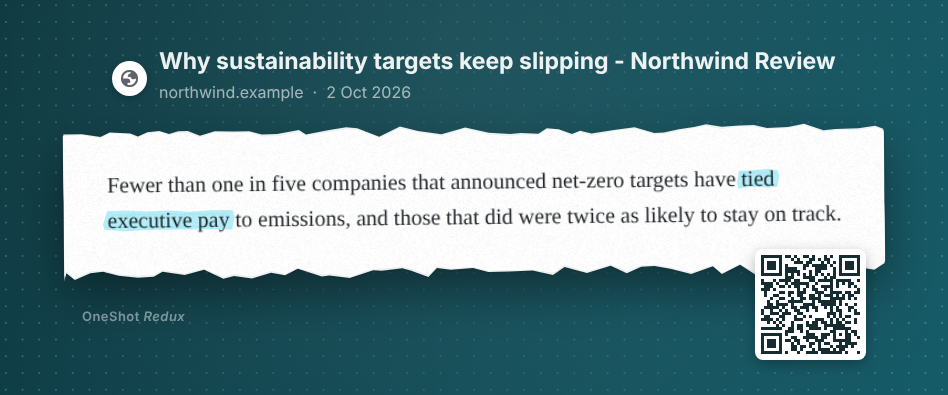
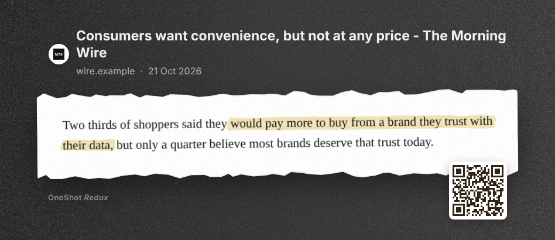
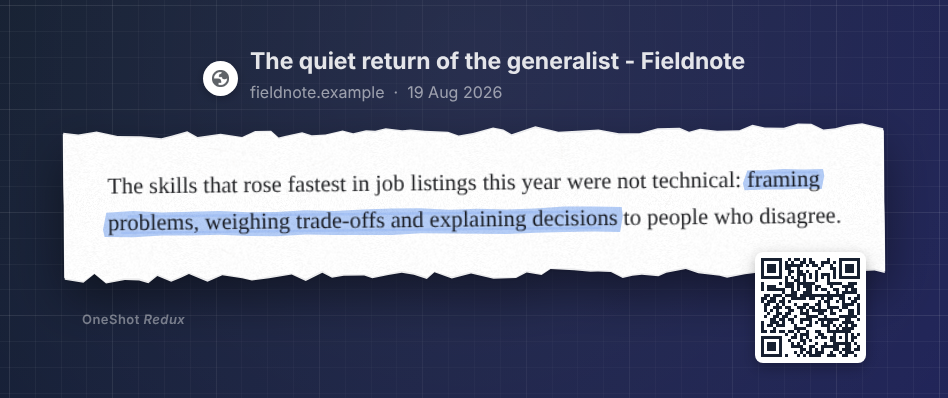
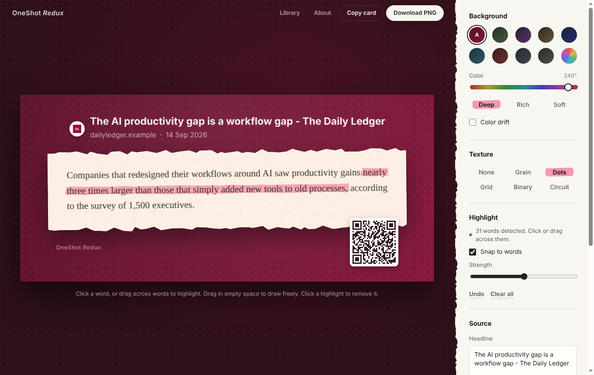
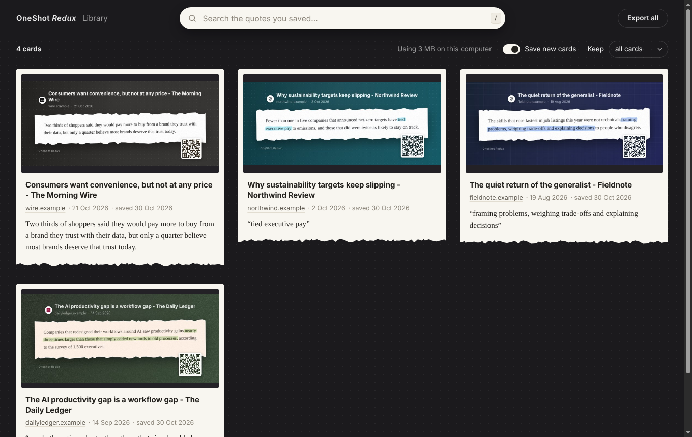

# OneShot Redux

**Screenshots deserve a library.** Highlight the interesting parts of the web, turn them
into beautiful cards worth sharing, and find any quote again, even when you've forgotten where you read it.

Select any part of a webpage and turn it into a polished quote card: a torn-paper
clipping with hand-drawn highlights, the article's headline, site, publish date and
icon on top, a background that picks up the publisher's colors, and a QR code back
to the source.

Free and open source. Everything runs on your computer; nothing is uploaded.

*Inspired by OneShot (2015) by Jason Goldman and Ian Ownbey, designed by Daniel Zarick.*

## See it in action

| Auto color from the site | Black-and-white logo | Your own color + texture |
|---|---|---|
|  |  |  |

### Your Library

Every card you copy or download is saved automatically, with its text. Search by any
words you remember from the quote, the headline or the site, then reopen a card to keep
editing, copy it again, or jump back to the source.

Publications and quotes in these images are fictional, made up for the demo.

## Install (from source)

1. Download or unzip this folder (`oneshot-redux`).
2. In Chrome, Edge, Brave or Arc, open `chrome://extensions`.
3. Turn on **Developer mode** (top right).
4. Click **Load unpacked** and choose the `oneshot-redux` folder.
5. Pin the extension: click the puzzle-piece icon in the toolbar, then the pin next to OneShot Redux.

**Safari (Mac):** for a quick try, open Safari → Settings → Developer → **Add Temporary
Extension…** and choose this folder (Safari removes it after 24 hours or when it quits).
For a permanent install, wrap it with Xcode:
`xcrun safari-web-extension-converter ./oneshot-redux --macos-only --app-name "OneShot Redux"`.

## Use

| Do this | What happens |
|---|---|
| Click the toolbar icon, or press **⌘⇧1** (Mac) / **Ctrl+Shift+1** (Windows) | The page dims and a hint bar appears |
| Drag a rectangle over some text | A new tab opens with your quote card |
| Press **F** while selecting | Captures the whole visible page |
| Press **Enter** while selecting, then drag (or press F) | **Quick copy:** the finished card, in your last-used style, goes straight to the clipboard. The toast offers **Edit** |
| Press **Esc** | Cancels |

In the editor:

| Do this | What happens |
|---|---|
| Click a word, or drag from one word to another | A hand-drawn marker highlight, one stroke per line |
| Drag in empty space (or untick **Snap to words**) | Freehand highlight |
| Click a highlight | Removes it (**⌘/Ctrl+Z** undoes) |
| **Auto** swatch (first, the default) | Background color taken from the site's theme color or icon (Plum if the site has none) |
| Other swatches, the rainbow swatch, the slider, Deep / Rich / Soft | Choose your own color; the rainbow swatch accepts any exact color |
| **Texture** | Grain, Dots, Grid, Binary or Circuit, faint and fading toward the quote |
| **Trim to content** (on by default) | Trims a rough selection to the text with even margins |
| Edit the headline or domain | The header updates |
| **Copy card** or **⌘C**, **Download PNG** or **⌘S** | Export the card |
| **Library** (or **⌘⇧L** / **Ctrl+Shift+L**) | Search and reopen every card you've copied or downloaded |
| **About** | Version and credits |

Your style choices are remembered between cards.

## Troubleshooting

- **Shortcut does nothing:** another app or extension may use it. Set your own at
  `chrome://extensions/shortcuts`.
- **Red "!" on the icon:** browsers don't let extensions run on some pages (`chrome://`
  pages, the extension stores, the New Tab page, built-in PDF viewers). Try a normal website.
- **Local files (`file://`):** allow it under `chrome://extensions` → OneShot Redux → Details →
  **Allow access to file URLs**.
- **Quick copy says "Couldn't copy on this page":** a few sites block clipboard access.
  Click **Open in editor** in the toast and copy from there.
- **Where are my cards?** Every card you copy or download (including quick copy) is in your
  **Library**. Captures you never copied or downloaded aren't kept long-term.
- **Back up your Library:** use **Export all** on the Library page. It downloads a zip with every
  card plus `library.csv` (quotes, sources, dates). Removing the extension deletes the Library.
- **Library taking too much space?** Each card is stored lightly (the capture plus your edits; the
  finished card is re-created exactly when you copy, download or export it). On the Library page you
  can turn off **Save new cards**, or set **Keep** to your newest 500 or 100 cards.
- **Errors:** on `chrome://extensions`, click **Errors** on the OneShot Redux card and share the message.

## Permissions

OneShot Redux asks for as little as possible. It only touches a page **when you start a
capture** (`activeTab`), so installing it shows no "read all your data" warning.

| Permission | Why |
|---|---|
| `activeTab`, `scripting` | Show the selector and take the screenshot on the page you're capturing |
| `storage`, `unlimitedStorage` | Remember your style and keep your Library (cards can be large) |
| `offscreen` | Render quick-copy cards without opening a tab |
| `favicon` | Chrome's built-in site icons, as a fallback |

See [PRIVACY.md](PRIVACY.md).

## How it works

- `background.js` captures the visible tab, crops it to your selection (accounting for
  Retina and zoom), fetches the site's icon, saves the capture and opens the editor.
- `content.js` draws the selector inside a Shadow DOM so site styles can't interfere,
  removes it *before* the screenshot, and reads the page's title, publish date
  (`article:published_time`, JSON-LD `datePublished` and similar), theme color and icons.
- `library.js` shows your saved cards (stored in the browser's IndexedDB, on your computer),
  searches their text, makes quick-copy cards searchable in the background, and builds the
  Export zip.
- `editor.js` renders the whole card on one canvas, so what you see is exactly what's
  exported. It trims the capture to its content, runs text detection in a background
  worker for word highlighting, and derives the Auto color. Quick copy runs the same
  renderer in a hidden offscreen page.

## Text detection

Word highlighting uses [Tesseract.js](https://github.com/naptha/tesseract.js) with a compact
English model, bundled in `lib/tesseract/`, so it works offline. Detection works best on clear,
regular-sized text; freehand highlighting covers everything else.

## License

[MIT](LICENSE) © 2026 Subrahmanyam KVJ. Bundled components keep their own
licenses; see [THIRD_PARTY_NOTICES.md](THIRD_PARTY_NOTICES.md).
